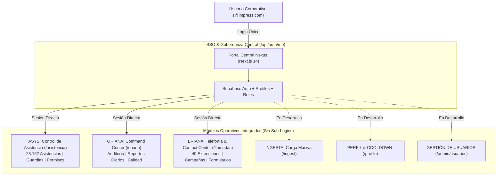

 # NEXUS INTRANET CORPORATIVA
## Documento Maestro de Estado, Arquitectura y Hoja de Ruta Viva
*Versión 2.0 — Noviembre 2026*  
*Entorno de Producción:* `https://nexus-system-three.vercel.app`  
*Base de Datos Central:* Supabase Managed PostgreSQL (AWS us-east-1)  

---

## 1. Resumen Ejecutivo del Estado del Sistema

**Nexus System** ha transitado exitosamente desde un conjunto heterogéneo de herramientas dispersas en Google Apps Script (GAS) y hojas de cálculo a una **plataforma empresarial unificada, reactiva y resiliente** desplegada en Vercel y respaldada por Supabase.

---

## 2. Balance de Fases Completadas (Fases 1 a 7.5)

### ✅ Fase 1: Arquitectura Base Monorepo & Infraestructura Vercel
- Estructuración de monorepo con **Turborepo** y **pnpm workspaces**.
- Integración de paquetes compartidos: `@intranet/auth`, `@intranet/database`, `@intranet/ui`.
- Configuración de `vercel.json` con enrutamiento de microservicios y headers de seguridad.

### ✅ Fase 2: Autenticación Corporativa y Gobernanza de Sesiones Seguras
- Módulo `/login` conectado a `auth.users` de Supabase.
- Manejo de sesiones mediante cookies HTTP-Only con `@supabase/ssr`.
- Middleware perimetral con exclusión de assets estáticos y redirección transparente de usuarios no autenticados.

### ✅ Fase 3: Escáner y Registro de Asistencia en Tiempo Real
- Marcado de entrada (Clock-In) y salida (Clock-Out).
- Geolocalización satelital y lectura de códigos QR.
- Generador de códigos QR maestros institucionales.

### ✅ Fase 4: Integración y Port Fiel de ORIANA Command Center
- Migración completa de la interfaz GAS original a Next.js App Router (`/oriana`).
- Port de base de datos a Supabase (`oriana_reportes_operadores`, `oriana_configuraciones`, `oriana_reglas_acceso`).
- Conexión de emulador `window.google.script.run` hacia API Routes serverless en Next.js.
- Generador de reportes diarios, KPIs porcentuales y módulo de auditoría de supervisión.

### ✅ Fase 5: Blindaje y Resiliencia Total F5 (Anti-404 y Anti-Crash)
- Manejo seguro de redirecciones en Server Components (`redirect` aislado fuera de bloques `try/catch`).
- Consultas seguras en Supabase (`.maybeSingle()` en lugar de `.single()`).
- Creación de pantalla amigable `not-found.tsx` y respuesta JSON 401 en endpoints de API.

### ✅ Fase 6: Montaje Completo de ASYS (Asistencia & Seguridad)
- Creación de 10 tablas relacionales en Supabase:
  - `asistencias`, `guardias`, `permisos`, `suplencias`, `cross_turnos`, `amonestaciones`, `tipos_amonestacion`, `config_horarios`, `solicitudes_manuales`, `permisos_roles`.
- Migración masiva desde `SYSTEM ASIS V8 (1).xlsx`: **28.162 asistencias históricas**, 48 guardias, 191 permisos, 27 suplencias, 236 amonestaciones y 10 configuraciones horarias.
- Porting de interfaz SB-Admin 2 completa a `/asistencia` (`apps/admin-portal/public/asys/index.html`).
- Dashboards diferenciados según rol: **Admin**, **Coordinador de Área** y **Usuario Operador**.

### ✅ Fase 7: Montaje Completo de BRIANA (Telefonía Celular & Contact Center)
- Creación de 6 tablas relacionales en Supabase:
  - `briana_campanas`, `briana_formularios`, `briana_data_campanas`, `briana_gestiones`, `briana_extensiones`, `briana_incidencias`.
- Sembrado de **49 extensiones corporativas** (`11001` a `11049`), 3 formularios dinámicos, 3 campañas activas (Cobranza Preventiva, Ventas, Fidelización) y registros de leads.
- Frontend empaquetado en `/llamadas` (`apps/admin-portal/public/briana/index.html`).
- Consola de discador guiado para terminales Samsung, gestión de colas y tipificación de llamadas en vivo.

### ✅ Fase 7.5: Single Sign-On (SSO) & Estandarización de Identidad `@impress.com`
- **Eliminación Total de Modales Secundarios:** Los usuarios ya no deben ingresar usuarios ni contraseñas adicionales al entrar a Asys, Oriana o Briana.
- **Endpoint Central de Identidad:** Creación de `/api/auth/me` que resuelve de forma atómica:
  - Correo institucional (`user.email`).
  - Nombre completo y cédula (`profiles.full_name`, `profiles.document_id`).
  - Roles institucionales (`superadmin`, `supervisor`, `multi_operator`).
  - Usuario interno legacy (`usuarios.usuario`).
  - Sub-Rol y permisos (`Informático/a`, `Admin`, `Analista`, `Operador/a`).
  - Extensión telefónica de Briana asignada.
  - Áreas operativas autorizadas.
- **Vinculación Masiva de Cuentas:** Vinculación de los 63 registros de `usuarios` con sus correspondientes cuentas `@impress.com`.
- **Provisión de Cuenta Maestra para Brando:** Configuración de `brando@impress.com` con permisos completos de `superadmin` e `Informático/a`.

---

### ✅ Fase 8: Ingesta Masiva de Datos (/ingest)
- Streaming parser para procesamiento de bases de datos masivas.
- Validación de números telefónicos y deduplicación automática.

### ✅ Fase 9: Perfil de Usuario con Cooldown de 7 Días (/profile)
- Autoservicio de personal para actualización de datos de contacto.
- Trigger y restricción a nivel de base de datos (`check_profile_cooldown`) con bloqueo estricto de 7 días entre modificaciones.

### ✅ Fase 10: Matriz de Gobierno RBAC y CRUD de Personal (/admin/usuarios y /users)
- Tablero de administración de personal para Superadministradores y Coordinadores.
- Creación, edición, congelamiento y reactivación de credenciales `@impress.com`.
- Asignación de extensiones telefónicas de Briana (`110xx`) y áreas de trabajo autorizadas para Asys y Oriana.

### ✅ Fase 11: Algoritmo de Scoring Dinámico y Telemetría de Latencia Inicial
- Medición del First Interaction Time (FIT) en la gestión telefónica.
- Scoring ponderado por agente: Asistencia y puntualidad (Asys: 30%) + Eficacia de contacto (Briana: 40%) + Precisión en reportes (Oriana: 30%).
- Endpoint `/api/admin/scoring` y función RPC `nexus_calculate_daily_scores` y `nexus_get_daily_leaderboard`.

### ✅ Fase 12: Purga Nocturna & Ciclo de Vida de Base de Datos (500 MB Free Tier)
- Función de auditoría y almacenamiento `nexus_get_database_storage_stats` (monitoreo en tiempo real: ~26 MB / 500 MB = 5.28% de cuota, estado HEALTHY).
- Función de archivado `archive_and_purge_lifecycle` con consolidación previa en agregados diarios (`registros_daily_aggregates`, `telemetry_daily_aggregates`, `call_daily_aggregates`) antes de purgar registros > 90 días.
- Endpoint `/api/admin/lifecycle` con soporte para invocación manual, dry-run y Vercel Cron nocturno (`0 4 * * *`).

### ✅ Fase 13: Reclasificación & Triage de Incidencias Comunitarias (/reclasificacion)
- Sustitución de hojas de cálculo de 10.5 MB por arquitectura relacional en Supabase (`reclasificacion_lotes`, `reclasificacion_registros`).
- Función SQL `public.nexus_repartir_reclasificacion(p_lote_id, p_operators)` para distribución atómica y equitativa de carga sin colisiones ni duplicados.
- Interfaz de Triage Rápido centrada en tarjeta: visualización completa del reporte ciudadano (Comuna, cédula, teléfono, descripción) con atajo de teclado `Ctrl + Enter` para calificar y avanzar sin fricción.
- Tablero de supervisión con leaderboard de avance por operador y resumen de efectividad global.
- Acceso exclusivo para el desarrollador Brando (`isBrando`) durante fase de calibración.

### ✅ Fase 14: Sala Nacional Electoral (/elecciones)
- Migración y porting completo del sistema electoral desde Google Apps Script a Next.js y Supabase.
- Monitoreo oficial de 335 municipios distribuidos en los 24 estados de Venezuela (`elecciones_municipios`).
- Reporte de participación en 9 franjas horarias (9:00 AM a 8:00 PM), centros activos 8:00 AM y mesas instaladas.
- Registro de movilización comunitaria y condominios movilizados.
- Centro de incidencias y alertas electorales en tiempo real (`elecciones_incidencias`).
- Acceso exclusivo para el desarrollador Brando (`isBrando`) durante fase de calibración.

### ✅ Fase 15: Sistema de Avisos Transversales & Estación de Trabajo en Lobby
- **Avisos Transversales (`GlobalNotificationOverlay.tsx`):** Inyección perimetral en `layout.tsx` con polling continuo. Interrumpe en pantalla con modal flotante prioritario y backdrop blur ante alertas urgentes o configuradas con `popup: true`, desplegándose sobre cualquier vista, modal o iframe abierto.
- **Emisión Segmentada (`EmitirAvisoModal.tsx` y `AdminHeaderActions.tsx`):** Botón directo "📢 Emitir Aviso" en la cabecera del Lobby para administradores. Envío global a toda la plataforma, por rol o a usuarios individuales seleccionados de la base de datos.
- **Despacho Operativo (`WorkstationQuickActions.tsx`):** Módulo "Iniciar Estación de Trabajo" en el Lobby con flujo guiado de inicio de turno (marcado en Asys, verificación de extensión Briana, asignación de Reclasificación y validación en Oriana).
- **Indicadores Dinámicos de Carga:** Resaltado de tarjetas y badges en el Lobby según trabajo asignado (`🔥 X llamadas pendientes` en Briana, `📋 X casos asignados` en Reclasificación, `⚠️ Entrada pendiente` en Asys).

---

## 4. Módulos Adicionales e Integraciones Planificadas

A medida que se desarrollen las fases pendientes, se integrarán de forma continua las siguientes herramientas:

1. **Bot de Notificaciones de Telegram Corporativo:**
   - Recordatorios automáticos de turnos y guardias a operadores (2 horas antes de la jornada).
   - Alerta inmediata a coordinadores cuando un operador no marca asistencia a los 15 minutos del inicio del turno.
   - Envío de resúmenes nocturnos a la gerencia con los indicadores clave del día.
2. **Exportador Unificado Excel / PDF:**
   - Descarga de reportes consolidados mensuales de asistencia con cálculo automático de horas laboradas, retrasos y justificaciones.
   - Exportación de libros de gestión telefónica y tipificaciones para auditorías externas.
3. **Dashboard Ejecutivo 360° (Cross-Module):**
   - Panel de control único para directores donde se visualiza la productividad global en tiempo real: agentes conectados en Briana, estado de asistencias en Asys e índice de cumplimiento en Oriana.

---

## 5. Tabla de Correspondencia de Usuarios e Identidad `@impress.com`

| Usuario Legacy | Correo Corporativo Nexus | Nombre Completo | Rol Nexus | Sub-Rol Asys/Oriana |
| :--- | :--- | :--- | :--- | :--- |
| `Brando` / `bgonzalez` | `brando@impress.com` / `bralez@impress.com` | Brando González | `superadmin` | Informático/a |
| `jmadrid` | `jhesus434@gmail.com` | Jesus Madrid | `supervisor` | Admin / Supervisor |
| `norly` | `norly@impress.com` | Norly Ariza | `data_analyst` | Analista |
| `franklin` | `frades@impress.com` | Franklin Cespedes | `multi_operator` | Operador/a |
| `janeth` | `janera@impress.com` | Janeth Figuera | `multi_operator` | Operador/a |
| `rina` | `rinuez@impress.com` | Rina Pedriquez | `multi_operator` | Operador/a |
| `mariag` | `valentinagzam@impress.com` | Maria García | `multi_operator` | Operador/a |
| `gisela` | `gisoca@impress.com` | Gisela Roca | `multi_operator` | Operador/a |
| `emily` | `emires@impress.com` | Emily Flores | `multi_operator` | Operador/a |
| `yessika` | `yesago@impress.com` | Yessika Indriago | `multi_operator` | Operador/a |
| `zdavila` | `zulila@impress.com` | Zuly Davila | `multi_operator` | Operador/a |
| `yosmely` | `yosoel@impress.com` | Yosmely Villarroel | `multi_operator` | Operador/a |
| `juanny` | `juaria@impress.com` | Juanny Tellería | `multi_operator` | Operador/a |
| `marielby` | `mcgg212002@impress.com` | Marielby Gonzalez | `multi_operator` | Analista |
| `diegov` | `diente@impress.com` | Diego Vicente | `multi_operator` | Operador/a |
| `elvis` | `elvjia@impress.com` | Elvis Toro | `multi_operator` | Operador/a |
| `admin` | `admin@empresa.com` | Admin Principal | `superadmin` | Superadmin |

*(Total de 63 usuarios corporativos completamente mapeados y sincronizados)*.
