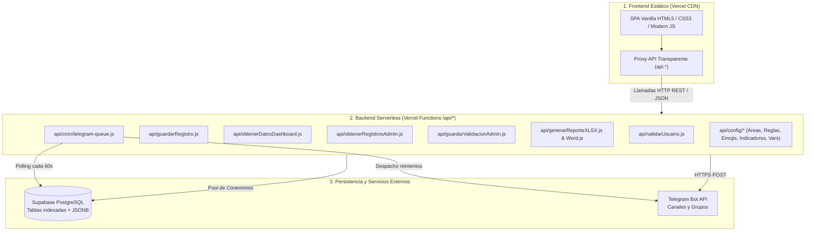

# MANUAL MAESTRO Y DOCUMENTACIÓN DEL SISTEMA ORIANA v2.0
### Sistema Integral de Gestión Operativa, Auditoría y Control de Actividades
**Plataforma:** Frontend en Vercel (Edge CDN) + Backend Serverless Node.js + Base de Datos Supabase (PostgreSQL) + Notificaciones Telegram

---

## 📑 ÍNDICE GENERAL

1. [Visión General y Propósito del Sistema](#1-visión-general-y-propósito-del-sistema)
2. [Arquitectura Tecnológica Integral](#2-arquitectura-tecnológica-integral)
3. [Módulo de Autenticación, Seguridad y Roles](#3-módulo-de-autenticación-seguridad-y-roles)
4. [Módulo Operativo de Carga de Reportes](#4-módulo-operativo-de-carga-de-reportes)
5. [Motor de Variables de Evaluación Dinámicas](#5-motor-de-variables-de-evaluación-dinámicas)
6. [Motor de Notificaciones y Telegram Bot](#6-motor-de-notificaciones-y-telegram-bot)
7. [Dashboard Analítico y Métricas](#7-dashboard-analítico-y-métricas)
8. [Consola Administrativa y Auditoría](#8-consola-administrativa-y-auditoría)
9. [Centro de Configuración Avanzada](#9-centro-de-configuración-avanzada)
10. [Módulo de Exportaciones (Excel y Word)](#10-módulo-de-exportaciones-excel-y-word)
11. [Diccionario de Datos y Esquema Supabase (PostgreSQL)](#11-diccionario-de-datos-y-esquema-supabase-postgresql)
12. [Catálogo de Endpoints de la API Serverless](#12-catálogo-de-endpoints-de-la-api-serverless)
13. [Guía de Despliegue, Variables de Entorno y CI/CD](#13-guía-de-despliegue-variables-de-entorno-y-cicd)

---

## 1. VISIÓN GENERAL Y PROPÓSITO DEL SISTEMA

**ORIANA** es una solución empresarial de alta concurrencia diseñada para registrar, auditar, analizar y notificar la operatividad diaria de múltiples equipos de trabajo distribuidos en turnos (Mañana, Tarde, Completo).

El sistema permite que los operadores y analistas ingresen su producción jornada tras jornada, alimentando:
- Indicadores en tiempo real (llamadas efectivas, llamadas totales, incidencias, casos atendidos y variables de evaluación específicas).
- Canales de supervisión en Telegram con alertas instantáneas formateadas con emojis institucionales.
- Un repositorio centralizado en PostgreSQL (Supabase) con auditoría estricta de cambios, validaciones administrativas y exportación automatizada de minutas e informes ejecutivos.

---

## 2. ARQUITECTURA TECNOLÓGICA INTEGRAL

El sistema se encuentra 100% desacoplado en tres capas:



### Características de Rendimiento
- **Carga Ultrarrápida:** El frontend se sirve desde la CDN global de Vercel en < 200 ms.
- **Paginación Antilímites:** Implementación de `fetchAllRows()` con `.range(from, to)` para evitar que PostgREST corte consultas en 1.000 filas.
- **Tolerancia a Fallos:** Si la API de Telegram se satura (error 429) o no responde, el mensaje se almacena automáticamente en la tabla `cola_telegram` para reintento automático vía cron.

---

## 3. MÓDULO DE AUTENTICACIÓN, SEGURIDAD Y ROLES

### 3.1. Roles del Sistema
1. **ADMIN:** Acceso irrestricto al sistema. Puede validar registros (individual y masivamente), configurar modos, campañas, áreas de trabajo, reglas de acceso, variables dinámicas, repositorio de emojis e indicadores macro.
2. **ANALISTA:** Perfil orientado a análisis de datos, revisión cualitativa y supervisión. Tiene permitido reportar múltiples actividades en un mismo registro y cuenta con exención de validación de duplicados.
3. **OPERADOR:** Perfil estándar operativo. Solo puede visualizar los modos y campañas habilitados según las **Reglas de Acceso** de su área o perfil, con validación de reporte único por jornada.

### 3.2. Turnos y Cruces
- **MAÑANA:** Jornada regular de mañana.
- **TARDE:** Jornada regular de tarde.
- **COMPLETO:** Doble turno / Todo el día.
- **Detección de Reporte Retardado:** Si el operador envía su reporte fuera del horario límite estipulado (por ejemplo, después de las 14:30 para turno Mañana o 19:30 para turno Tarde), el reporte se marca automáticamente con la alerta visual `🚨🚨 REPORTE RETARDADO 🚨🚨` en Telegram.

### 3.3. Algoritmo Criptográfico
Las contraseñas se validan mediante hash **SHA-256** generado con el módulo nativo `crypto` de Node.js, manteniendo compatibilidad con credenciales preexistentes.

---

## 4. MÓDULO OPERATIVO DE CARGA DE REPORTES

### 4.1. Flujo de Envío
1. **Selección de Modo:** Al seleccionar un modo (ej. `ISSABEL`, `1x10`, `INCIDENCIAS`, `ANALISTA`), la interfaz adapta dinámicamente sus campos.
2. **Selección de Campaña/Actividad:** Muestra únicamente las campañas asociadas a dicho modo mediante la configuración vinculada.
3. **Entrada de Datos Operativos:**
   - **Métricas clásicas:** Llamadas Efectivas, Llamadas Totales, Incidencias, Estados Abarcados, Municipios/Detalles.
   - **Modo Analista:** Lista dinámica de actividades con checkbox y textarea de detalle.
   - **Variables de Evaluación:** Formulario dinámico generado en tiempo real según las variables configuradas para ese modo.
4. **Contador de Seguridad (Countdown de 10 segundos):**
   - Antes de impactar la base de datos y Telegram, el operador dispone de un overlay con cuenta regresiva para cancelar el envío si detecta algún error de digitación.

---

## 5. MOTOR DE VARIABLES DE EVALUACIÓN DINÁMICAS

Una de las capacidades más avanzadas de ORIANA v2.0 es la parametrización de variables personalizadas por modo sin alterar la estructura física de la base de datos:

### 5.1. Atributos de una Variable
- **Variable (Clave interna):** Identificador alfanumérico (ej: `total_fichas`, `casos_resueltos`).
- **Etiqueta (Label visual):** Texto descriptivo visible para el operador (ej: *"Total Fichas Elaboradas"*).
- **Tipo:** `NUMERO` o `TEXTO`.
- **Obligatorio:** `SI` o `NO`.
- **Depende De (Padre):** Permite anidar variables jerárquicas (árbol de dependencias). En Telegram y en la UI se muestran indentadas con el conector `└`.

### 5.2. Almacenamiento
En Supabase, los valores se guardan en la columna `variables` de la tabla `registros` como objeto `JSONB` indexado, permitiendo consultas analíticas de alto rendimiento.

---

## 6. MOTOR DE NOTIFICACIONES Y TELEGRAM BOT

### 6.1. Estructura del Mensaje Institucional
Cada reporte enviado por un operador genera un mensaje HTML estructurado con la siguiente anatomía:

```text
📊 REPORTE DE OPERATIVIDAD 📊
➖➖➖➖➖➖➖➖➖➖
👤 Operador: JUAN PÉREZ
💼 Rol: Operador
🕒 Jornada: MAÑANA
📅 Fecha: 2026-11-03
➖➖➖➖➖➖➖➖➖➖

📞 MODO: ATENCIÓN TELEFÓNICA
   📌 Actividad: MONITOREO DE CASOS
   📊 Llamadas Efectivas: 45
   ☎️ Llamadas Totales: 50
   ⚠️ Incidencias: 3
      └ Casos Derivados: 12
   🗺️ Estados Abarcados: DISTRITO CAPITAL, MIRANDA

➖➖➖➖➖➖➖➖➖➖
📋 TOTAL ACTIVIDADES REPORTADAS: 1

📊 TOTALES POR INDICADOR:
📞 ATENCIÓN GENERAL (ATENCIÓN TELEFÓNICA)
   📊 Llamadas Efectivas: 45
   └ Casos Derivados: 12
```

### 6.2. Repositorio de Emojis Dinámico
El sistema consulta la tabla `config_emojis` para asociar íconos específicos a cada **Modo**, **Campaña** o **Variable**, eliminando íconos fijos o "hardcodeados" en el código.

### 6.3. Reportes Consolidados Programados (Diario y Semanal)
- **Consolidado Diario:** Se compila a las 18:00 hrs con el resumen total de efectividad, llamadas y variables de todos los operadores del día anterior.
- **Consolidado Semanal:** Se emite los domingos a las 18:00 hrs resumiendo los últimos 7 días.
- **Destinatarios Flexibles:** Gestionados desde `config_destinatarios` con activación/desactivación por chat individual o grupal.

---

## 7. DASHBOARD ANALÍTICO Y MÉTRICAS

El panel analítico permite a coordinadores y directores evaluar el rendimiento en cualquier ventana de tiempo:
- **Filtro por Rango de Fechas:** Selector interactivo (Hoy, Semana, Mes, Personalizado).
- **Filtro por Operador:** Consulta global (`TODOS`) o individual.
- **KPIs Principales:** Total Efectivas / Realizadas y Total Asignadas / Procesadas.
- **Tabla de Desglose por Modo:** Ordenada descendentemente por producción.
- **Tabla de Desglose por Variables de Evaluación:** Agrupación dinámica de los totales de cada variable registrada en el período.

---

## 8. CONSOLA ADMINISTRATIVA Y AUDITORÍA

### 8.1. Tabla Maestra de Registros
- **Paginación Inteligente:** Selección de 10, 20 o 50 registros por página.
- **Paginación Serverless Completa:** Eliminado el límite de 1.000 filas de PostgREST gracias a bloques `.range()`.
- **Filtros Combinables:** Por fecha exacta, modo de trabajo, operador, turno y dos cuadros de búsqueda de texto libre.

### 8.2. Validación Administrativa
Los coordinadores pueden auditar la producción reportada ingresando los valores corregidos en las columnas:
- **Val. Efec:** Efectivas verificadas administrativamente.
- **Val. Inc:** Incidencias verificadas administrativamente.
- **Modalidades de Guardado:** Guardado individual inmediato o validación masiva por lote con auditoría en la tabla `logs_auditoria`.

---

## 9. CENTRO DE CONFIGURACIÓN AVANZADA

Accesible exclusivamente para usuarios con rol `ADMIN`:

1. **Gestión de Áreas de Trabajo (`areas_trabajo`):** Salas, pisos y sedes físicas.
2. **Reglas de Acceso (`reglas_acceso`):** Asignación de qué modos están permitidos para Operadores, Analistas o Perfiles Especiales (`*` para todos).
3. **Gestión de Modos y Campañas (`configuracion`):** Alta de nuevos modos operativos y sus listas de campañas asociadas separadas por coma.
4. **Variables de Evaluación por Modo (`config_variables`):** Definición de variables numéricas/texto con dependencias.
5. **Repositorio de Emojis (`config_emojis`):** Configuración de emojis oficiales por modo, campaña y variable.
6. **Indicadores Macro (`config_indicadores`):** Vinculación de modos bajo un mismo indicador paraguas.
7. **Destinatarios de Reportes Programados (`config_destinatarios`):** Chat IDs de Telegram suscritos a reportes automáticos.

---

## 10. MÓDULO DE EXPORTACIONES (EXCEL Y WORD)

### 10.1. Exportación a Excel (`.xlsx`)
- Utiliza la librería **`exceljs`** en el entorno Node.js Serverless.
- Incorpora automáticamente como columnas todas las **Variables de Evaluación** dinámicas presentes en los registros consultados.
- Añade fila de **TOTALES** acumulativa con cálculo matemático en la última fila.
- Aplica formato corporativo con cabeceras estilizadas en azul institucional (`#1E40AF`).

### 10.2. Exportación a Microsoft Word (`.doc`)
- Genera un documento multipart compatible con Word a partir de un template HTML estructurado.
- Tres modalidades de exportación:
  1. *Reporte General Consolidado:* Resumen ejecutivo por modo con variables.
  2. *Reporte General por Modo:* Desglose detallado agrupado por actividad.
  3. *Reporte General por Operadores:* Informe nominal individual de cada operador con su turno.

### 10.3. Creación Dinámica de Hojas de Cálculo por Modo de Trabajo
- **Arquitectura Centrada en el Modo:** La organización de hojas y archivos de cálculo se estructura **exclusivamente por Modo de Trabajo** (ej. `Modo_LLAMADAS`, `Modo_ISSABEL`, `Modo_1X10`, `Modo_ANALISTA`), y no por indicadores macro ni exportaciones aisladas.
- **Los Indicadores son Columnas:** Dentro de cada hoja de modo, los indicadores y variables de evaluación correspondientes se configuran dinámicamente como **columnas** individuales, integradas armónicamente con los datos operativos:
  - `ID_Operador`
  - `Fecha`
  - `Hora`
  - `Nombre y Apellido`
  - `Usuario`
  - `Turno`
  - `Modo`
  - `Campaña / Actividad`
  - `[Columnas de Indicadores / Variables del Modo]` (ej. *Llamadas Efectivas*, *Llamadas Totales*, *Incidencias*, o variables dinámicas de `config_variables`)
  - `Estados`
  - `Municipios / Detalle`
  - `(Admin) Efectivas`
  - `(Admin) Incidencias`
  - `Total`
- **Inserción Automática en Tiempo Real:** Al recibir cualquier reporte, el sistema guarda en la base consolidada global (`registros` en Supabase o `BD_Registros` en Google Sheets) y simultáneamente en la hoja del modo de trabajo respectivo (`guardarEnHojaModo`).
- **Sincronización y Reconstrucción (`actualizarHojasPorModo`):** Permite sincronizar en bloque todas las hojas por modo en el Spreadsheet y en la carpeta Drive `ORIANA_Modos_Trabajo`, manteniendo retrocompatibilidad con `actualizarArchivosIndicadores`.

---

## 11. DICCIONARIO DE DATOS Y ESQUEMA SUPABASE (POSTGRESQL)

```sql
-- TABLA: usuarios
usuarios (
    usuario TEXT PRIMARY KEY,
    clave TEXT NOT NULL,
    nombre_apellido TEXT,
    rol TEXT DEFAULT 'Operador',
    turno TEXT DEFAULT 'MAÑANA',
    id_user TEXT,
    cedula TEXT,
    backup_clave_original TEXT,
    created_at TIMESTAMPTZ DEFAULT NOW(),
    updated_at TIMESTAMPTZ DEFAULT NOW()
);

-- TABLA: registros
registros (
    id BIGSERIAL PRIMARY KEY,
    id_operador TEXT DEFAULT 'S/ID',
    fecha_registro TIMESTAMPTZ DEFAULT NOW(),
    fecha_reporte TEXT NOT NULL, -- YYYY-MM-DD
    usuario_operador TEXT NOT NULL,
    modo_trabajo TEXT NOT NULL,
    campana TEXT NOT NULL,
    llamadas_efectivas NUMERIC DEFAULT 0,
    llamadas_totales NUMERIC DEFAULT 0,
    incidencias_reportadas NUMERIC DEFAULT 0,
    estados_abarcados TEXT DEFAULT '',
    municipios_detalles TEXT DEFAULT '',
    admin_efectivas NUMERIC,
    admin_incidencias NUMERIC,
    variables JSONB DEFAULT '{}'::jsonb,
    created_at TIMESTAMPTZ DEFAULT NOW()
);

-- TABLA: config_variables
config_variables (
    id SERIAL PRIMARY KEY,
    modo TEXT NOT NULL,
    variable TEXT NOT NULL,
    etiqueta TEXT,
    tipo TEXT DEFAULT 'NUMERO',
    obligatorio BOOLEAN DEFAULT false,
    depende_de TEXT DEFAULT '',
    updated_at TIMESTAMPTZ DEFAULT NOW()
);

-- TABLA: config_emojis
config_emojis (
    id SERIAL PRIMARY KEY,
    tipo TEXT NOT NULL,
    nombre TEXT NOT NULL,
    emoji TEXT NOT NULL,
    updated_at TIMESTAMPTZ DEFAULT NOW(),
    UNIQUE(tipo, nombre)
);

-- TABLA: config_destinatarios
config_destinatarios (
    id SERIAL PRIMARY KEY,
    chat_id TEXT NOT NULL UNIQUE,
    frecuencia TEXT DEFAULT 'DIARIO',
    activo BOOLEAN DEFAULT true,
    updated_at TIMESTAMPTZ DEFAULT NOW()
);

-- TABLA: config_indicadores
config_indicadores (
    id SERIAL PRIMARY KEY,
    indicador TEXT NOT NULL,
    modo TEXT NOT NULL,
    updated_at TIMESTAMPTZ DEFAULT NOW()
);

-- TABLA: cola_telegram
cola_telegram (
    id_cola UUID PRIMARY KEY DEFAULT gen_random_uuid(),
    fecha_encola TIMESTAMPTZ DEFAULT NOW(),
    estado TEXT DEFAULT 'PENDIENTE', -- PENDIENTE, ENVIADO, ERROR
    intentos INTEGER DEFAULT 0,
    payload JSONB NOT NULL,
    updated_at TIMESTAMPTZ DEFAULT NOW()
);

-- TABLA: logs_auditoria
logs_auditoria (
    id BIGSERIAL PRIMARY KEY,
    fecha_hora TIMESTAMPTZ DEFAULT NOW(),
    usuario TEXT,
    accion TEXT,
    detalle TEXT,
    rol TEXT
);
```

---

## 12. CATÁLOGO DE ENDPOINTS DE LA API SERVERLESS

Todos los endpoints responden a peticiones `POST` recibiendo `{ args: [...] }`:

| Endpoint | Parámetros Principales | Descripción |
| :--- | :--- | :--- |
| `/api/validarUsuario` | `[usuario, clave]` | Autentica contra `usuarios` con hash SHA-256 |
| `/api/guardarRegistro` | `[pkg]` | Inserta en `registros` y envía notificación Telegram |
| `/api/obtenerDatosDashboard` | `[f1, f2, usuario]` | Agregación de métricas y variables sin límite de filas |
| `/api/obtenerRegistrosAdmin` | `[p, c, t1, t2, fd, modos, ops, tipo, turnos]` | Paginación y filtrado administrativo avanzado |
| `/api/guardarValidacionAdmin` | `[rowId, ef, inc, user, rol]` | Validación individual de fila con auditoría |
| `/api/guardarValidacionMasiva` | `[lista, user, rol]` | Validación de lote de filas con auditoría |
| `/api/obtenerTodasVariables` | `[]` | Diccionario completo de variables por modo |
| `/api/guardarVariablesModo` | `[modo, lista]` | Actualiza las variables dinámicas de un modo |
| `/api/obtenerEmojis` | `[]` | Mapeo de emojis para modos, campañas y variables |
| `/api/guardarEmojis` | `[lista]` | Guarda el repositorio de emojis |
| `/api/obtenerIndicadores` | `[]` | Mapeo de indicadores macro a modos |
| `/api/guardarIndicadores` | `[lista]` | Actualiza los indicadores macro |
| `/api/obtenerDestinatarios` | `[]` | Lista de destinatarios de reportes programados |
| `/api/guardarDestinatarios` | `[lista]` | Guarda los destinatarios programados |
| `/api/generarReporteXLSX` | `[f1, f2, fm]` | Genera archivo Excel con columnas dinámicas |
| `/api/generarReporteWord` | `[f1, f2, tipo]` | Genera documento Word formateado |
| `/api/cron/telegram-queue` | `(GET/POST vía Vercel Cron)` | Procesa reintentos de mensajes pendientes en cola |

---

## 13. GUÍA DE DESPLIEGUE, VARIABLES DE ENTORNO Y CI/CD

### 13.1. Variables de Entorno Requeridas en Vercel
Configurar en **Project Settings $\to$ Environment Variables**:
- `SUPABASE_URL`: URL del proyecto (ej: `https://xyzcompany.supabase.co`).
- `SUPABASE_SERVICE_ROLE_KEY`: Clave de servicio para operaciones seguras en el backend.
- `SUPABASE_ANON_KEY`: Clave pública anon de Supabase.
- `TELEGRAM_BOT_TOKEN`: Token otorgado por BotFather.
- `CHAT_ID_TELEGRAM`: ID del chat o canal principal.
- `CRON_SECRET`: Secreto para autenticar llamadas de Vercel Cron.

### 13.2. Configuración de PostgREST en Supabase
Para proyectos con grandes volúmenes de datos históricos:
1. Ir a **Project Settings $\to$ API $\to$ PostgREST configuration**.
2. Cambiar **Max Rows** de `1000` a `10000` o `50000`.
3. Guardar cambios. *(El código del backend cuenta además con paginación automática `fetchAllRows()` como doble seguro).*

### 13.3. Pipeline de Despliegue Continuo (CI/CD)
- El repositorio está vinculado a **`https://github.com/Dobran98/Oriana.git`**.
- Cada `git push origin main` activa inmediatamente un nuevo build y despliegue en Vercel sin tiempos de inactividad (*Zero-Downtime Deployment*).

