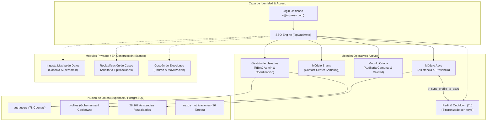
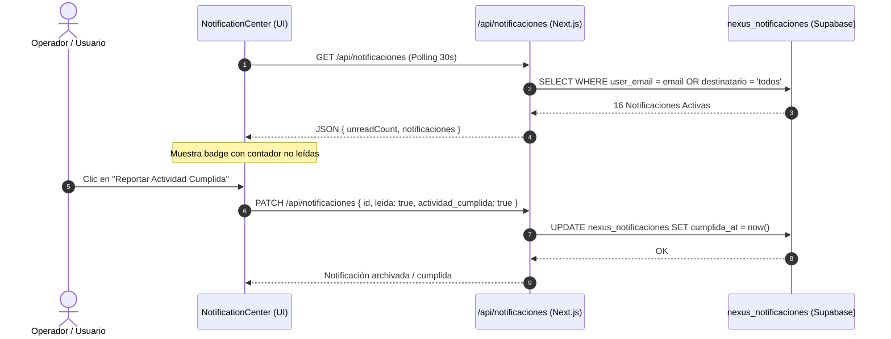

# INFORME EJECUTIVO & BALANCE GENERAL DE PLATAFORMA
## NEXUS INTRANET SYSTEM — VERSIÓN 2.0 (NOVIEMBRE 2026)

---

### 1. Resumen Ejecutivo de la Plataforma

**Nexus System** es el ecosistema institucional centralizado para el control operativo, presencia laboral, contact center telefónico y auditoría analítica de la organización. La plataforma ha sido consolidada bajo una arquitectura moderna basada en **Next.js 14**, **Supabase Auth (SSO Corporativo `@impress.com`)**, **PostgreSQL con RLS** y despliegue continuo en la nube a través de **Vercel Multi-Service**.

El presente documento constituye el **balance cuantitativo y cualitativo definitivo** de la infraestructura, abarcando el estado de cada uno de los 8 módulos (activos, en construcción y privados), el censo de usuarios y roles, los registros respaldados de bases de datos heredadas y los sistemas de trazabilidad y gobernanza recientemente implementados.

---

### 2. Balance Cuantitativo de la Base de Datos (Auditoría en Producción)

A continuación se detalla el censo exacto de registros extraídos directamente de la base de datos de producción en Supabase:

#### 2.1 Censo de Cuentas, Identidades y Roles

| Tabla / Entidad | Conteo Real | Descripción / Propósito |
| :--- | :---: | :--- |
| `auth.users` | **78** | Cuentas oficiales de autenticación con credenciales cifradas (Bcrypt) y confirmadas. |
| `public.profiles` | **78** | Perfiles institucionales con cédula, teléfono, dirección y control de cuota semanal. |
| `public.user_roles` | **79** | Asignaciones activas de roles dentro del modelo RBAC institucional. |
| `public.usuarios` | **63** | Registros sincronizados en tiempo real para compatibilidad legacy (Asys / Briana). |
| `public.roles` | **6** | Catálogo oficial de roles jerárquicos del sistema. |

**Distribución de Personal por Roles:**
- **Operadores Multifunción (`multi_operator`):** 58 colaboradores (74.4%)
- **Analistas de Calidad y Datos (`data_analyst`):** 9 colaboradores (11.5%)
- **Supervisores de Sala (`supervisor`):** 8 colaboradores (10.3%)
- **Superadministradores (`superadmin`):** 3 cuentas (incluye perfil exclusivo Founder de Brando)
- **Administrador de Módulo (`module_admin`):** 1 cuenta

#### 2.2 Balance de Registros Respaldados y Operaciones

| Sistema / Módulo | Tabla de Base de Datos | Filas Respaldadas | Estado Operativo |
| :--- | :--- | :---: | :--- |
| **Asys (Asistencia)** | `public.asistencias` | **28,162** | Migración 100% íntegra desde SQLite histórico. |
| **Asys (Registros)** | `public.registros` | **6,967** | Marcas y transacciones de personal en reloj. |
| **Asys (Disciplinario)**| `public.amonestaciones` | **236** | Historial de faltas y amonestaciones operativas. |
| **Asys (Permisos)** | `public.permisos` | **191** | Licencias médicas, permisos y justificaciones. |
| **Asys (Guardias)** | `public.guardias` | **48** | Planificación de turnos especiales de fin de semana. |
| **Asys (Suplencias)** | `public.suplencias` | **27** | Registro de reemplazos de personal. |
| **Asys (Solicitudes)** | `public.solicitudes_manuales`| **21** | Correcciones manuales de marcajes solicitadas. |
| **Briana (Telefonía)** | `public.briana_extensiones` | **49** | Extensiones telefónicas configuradas para Samsung. |
| **Briana (Campañas)** | `public.briana_campanas` | **3** | Campañas activas en discador guiado. |
| **Briana (Data Lotes)**| `public.briana_data_campanas`| **8** | Bloques de datos de contactos para discado. |
| **Briana (Gestiones)** | `public.briana_gestiones` | **3** | Historial inicial de tipificaciones telefónicas. |
| **Oriana (Auditoría)** | `public.oriana_reports` | **9** | Reportes consolidados de lotes comunales. |
| **Oriana (Métricas)** | `public.oriana_metrics` | **9** | Métricas analíticas de precisión porcentual. |
| **Oriana (Vistas)** | `v_analyst_daily_performance`| **144** | Récords calculados de rendimiento por analista. |
| **Notificaciones** | `public.nexus_notificaciones`| **16** | Tareas activas y recordatorios corporativos. |
| **Auditoría General** | `public.logs_auditoria` + `audit_logs` | **911** | Trazas criptográficas e historial de eventos. |

---

### 3. Balance Detallado por Módulo

#### Módulo 1: Módulo Asys (Control de Presencia, Turno & Asistencia)
- **Ruta de Acceso:** `/asistencia` (embebe `/asys/index.html`)
- **Estado:** 🟢 **ACTIVO AHORA**
- **Nivel de Acceso (RBAC):** Todos los colaboradores con correo `@impress.com`.
- **Funcionamiento y Características:**
  - Sistema Integral de Control de Asistencia, Seguridad Institucional y Guardias.
  - Marcado de entrada (*Clock-In*), pausas y salida (*Clock-Out*) con registro de hora oficial de servidor.
  - Almacena **28,162 registros históricos** accesibles en línea para reportes de nómina y puntualidad.
  - Gate de Identidad interactivo que saluda al usuario en sesión sin solicitar contraseñas secundarias.
  - **Enlace con Perfil:** Dispone en su barra superior del botón `Mi Perfil & Cooldown (7d)` para que el operador acceda directamente a su ficha de datos personales.

#### Módulo 2: Módulo Briana (Contact Center Telefónico sin PBX)
- **Ruta de Acceso:** `/llamadas` (embebe `/briana/index.html`)
- **Estado:** 🟢 **ACTIVO AHORA**
- **Nivel de Acceso (RBAC):** Operadores telefónicos, Supervisores y Administradores.
- **Funcionamiento y Características:**
  - Plataforma de emisión de llamadas guiadas diseñada para terminales Samsung corporativos.
  - Discado manual y asistido sin requerir centralita física PBX.
  - Formulario de tipificación de llamadas en caliente (Efectivo, No contesta, Ocupado, Rechazado) con registro de incidencias técnicas.
  - **49 extensiones institucionales** mapeadas y asignadas a los puestos de trabajo.
  - Bypass de login unificado: la sesión de Nexus alimenta la extensión y el operador activo automáticamente.

#### Módulo 3: Módulo Oriana (Command Center de Auditoría y Calidad)
- **Ruta de Acceso:** `/oriana` (embebe `/oriana/index.html`)
- **Estado:** 🟢 **ACTIVO AHORA**
- **Nivel de Acceso (RBAC):** Analistas de Datos (`data_analyst`), Supervisores y Administradores.
- **Funcionamiento y Características:**
  - Centro de evaluación analítica y control de calidad de datos comunales.
  - Auditoría de lotes procesados con cálculo automático de precisión porcentual y registros por hora.
  - Tabla de posiciones (Ranking) y rendimiento diario de analistas (`v_analyst_daily_performance`).
  - Monitoreo de 9 reportes y métricas de producción en tiempo real.

#### Módulo 4: Perfil y Cooldown (7 Días) — Enlazado a Asys
- **Ruta de Acceso:** `/profile`
- **Estado:** 🟢 **ACTIVO AHORA**
- **Nivel de Acceso (RBAC):** Todos los usuarios autenticados.
- **Funcionamiento y Características:**
  - Panel interactivo con el componente reactivo `ProfileRestrictionPanel`.
  - Muestra datos institucionales de solo lectura (Cédula, Correo, Rol) y permite editar datos de contacto: **Teléfono** y **Dirección Domiciliaria**.
  - **Política de Cooldown de 7 Días:** Cada modificación bloquea el formulario con un temporizador digital en cuenta regresiva (Días, Horas, Minutos, Segundos).
  - **Trigger en BD (`tr_sync_profile_to_asys`):** Cualquier cambio de teléfono o dirección en `profiles` se sincroniza instantáneamente en la tabla `usuarios` de Asys.
  - Dispone de botón directo en la cabecera hacia el `Módulo Asys`.

#### Módulo 5: Ingesta Masiva de Datos
- **Ruta de Acceso:** `/ingest`
- **Estado:** 🔒 **PRIVADO / EXCLUSIVO BRANDO**
- **Nivel de Acceso (RBAC):** Exclusivamente para la cuenta de desarrollador de Brando (`isBrando`). Oculto e inaccesible para cualquier otro usuario.
- **Funcionamiento y Características:**
  - Consola de experimentación y carga por lotes de archivos CSV y Excel (XLSX).
  - Algoritmo heurístico de detección de duplicados telefónicos y asignación masiva de contactos a campañas.
  - Reservado temporalmente para pruebas y validaciones internas antes de su liberación pública.

#### Módulo 6: Gestión Corporativa de Usuarios
- **Ruta de Acceso:** `/users` (alimentado por `/api/admin/users`)
- **Estado:** 🟢 **ACTIVO AHORA**
- **Nivel de Acceso (RBAC):** `superadmin`, `module_admin` y `Coordinador General`. Oculto para el resto del personal.
- **Funcionamiento y Características:**
  - Tablero centralizado de gobierno de identidad con buscador reactivo por nombre, correo `@impress`, cédula o usuario legacy.
  - Tarjetas superiores de KPIs con el conteo de cuentas activas, suspendidas, administradores y operadores.
  - **Creación de Usuarios:** Formulario atómico que crea al usuario en `auth.users` (hash Bcrypt, tokens limpios `''`), `profiles`, `user_roles` y `usuarios` (Asys/Briana).
  - **Edición Completa:** Modificación de roles, cargos, turnos, sedes y estado (Activar / Suspender).
  - **Reseteo de Clave de 1-Clic:** Modal rápido para cambiar contraseñas de operadores.
  - **Liberación de Cooldown (7d):** Botón administrativo que resetea `last_profile_edit_at = NULL`, permitiendo que un usuario vuelva a editar su perfil inmediatamente sin esperar la semana.

#### Módulo 7: Reclasificación de Casos
- **Ruta de Acceso:** `/en-construccion?modulo=Reclasificación`
- **Estado:** 🚧 **EN CONSTRUCCIÓN (PRIVADO BRANDO)**
- **Nivel de Acceso (RBAC):** Exclusivo para el perfil de desarrollador de Brando (`isBrando`).
- **Propósito y Diseño:**
  - Módulo de auditoría operativa para revisar grabaciones/gestiones telefónicas y corregir tipificaciones erróneas en caliente.
  - Mantendrá versionado del cambio: quién reclasificó, motivo del ajuste y recálculo de métricas de campaña.

#### Módulo 8: Gestión de Elecciones
- **Ruta de Acceso:** `/en-construccion?modulo=Gestión+de+Elecciones`
- **Estado:** 🚧 **EN CONSTRUCCIÓN (PRIVADO BRANDO)**
- **Nivel de Acceso (RBAC):** Exclusivo para el perfil de desarrollador de Brando (`isBrando`).
- **Propósito y Diseño:**
  - Plataforma de seguimiento electoral: catálogo jerárquico de Centros de Votación por Estado, Municipio y Parroquia.
  - Consultor del padrón electoral por cédula, asignación de movilizadores y tablero en tiempo real (*War Room*) de participación ciudadana el día del evento.

---

### 4. Sistema Centralizado de Notificaciones y Tareas

El componente reactivo `NotificationCenter` está desplegado en la barra superior de todas las secciones principales del portal (`/`, `/profile`, `/users`).

- **Almacenamiento:** Tabla `public.nexus_notificaciones` con 16 notificaciones activas indexadas por usuario y fecha.
- **Categorías:** Asignaciones de campaña, alertas de presencia, recordatorios de reclasificación y avisos corporativos.
- **Trazabilidad:** Al pulsar *"Reportar Actividad Cumplida"*, el registro almacena la marca temporal y el estado de cumplimiento en la base de datos.

---

### 5. Matriz de Acceso y Visibilidad por Rol (RBAC)

| Módulo / Funcionalidad | Superadmin (Brando) | Module Admin | Coordinador General | Supervisor de Sala | Operador Telefónico | Analista de Datos |
| :--- | :---: | :---: | :---: | :---: | :---: | :---: |
| **Módulo Asys (Presencia)** | ✅ Total | ✅ Total | ✅ Total | ✅ Total | ✅ Total | ✅ Total |
| **Módulo Briana (Telefonía)**| ✅ Total | ✅ Total | ✅ Total | ✅ Total | ✅ Total | ❌ Oculto |
| **Módulo Oriana (Calidad)** | ✅ Total | ✅ Total | ✅ Total | ✅ Total | ❌ Oculto | ✅ Total |
| **Perfil & Cooldown (7d)** | ✅ Total | ✅ Total | ✅ Total | ✅ Total | ✅ Total | ✅ Total |
| **Gestión de Usuarios** | ✅ Total | ✅ Total | ✅ Total | ❌ Oculto | ❌ Oculto | ❌ Oculto |
| **Liberar Cooldown 7d** | ✅ Total | ✅ Total | ✅ Total | ❌ Denegado | ❌ Denegado | ❌ Denegado |
| **Ingesta Masiva** | 🔒 Exclusivo | ❌ Oculto | ❌ Oculto | ❌ Oculto | ❌ Oculto | ❌ Oculto |
| **Reclasificación (Dev)** | 🔒 Exclusivo | ❌ Oculto | ❌ Oculto | ❌ Oculto | ❌ Oculto | ❌ Oculto |
| **Gestión Elecciones (Dev)**| 🔒 Exclusivo | ❌ Oculto | ❌ Oculto | ❌ Oculto | ❌ Oculto | ❌ Oculto |

---

### 6. Balance de Infraestructura y Despliegue

- **Repositorio:** `https://github.com/Dobran98/Nexus-System.git`
- **Rama Principal:** `main`
- **Último Commit Desplegado:** `b6c1d21` (*feat(asys): link profile and 7d cooldown with Asys module, bidirectional navigation and database trigger*)
- **Estado de Build:** `turbo run build` exitoso (`18/18` páginas estáticas y dinámicas compiladas, 0 errores de TypeScript).
- **Hosting en Producción:** [nexus-system-three.vercel.app](https://nexus-system-three.vercel.app)
