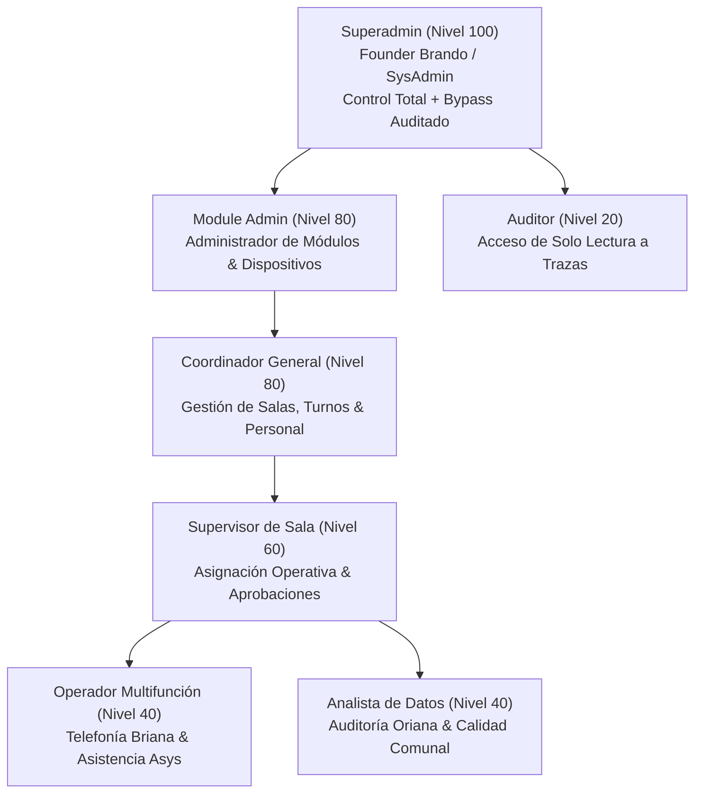
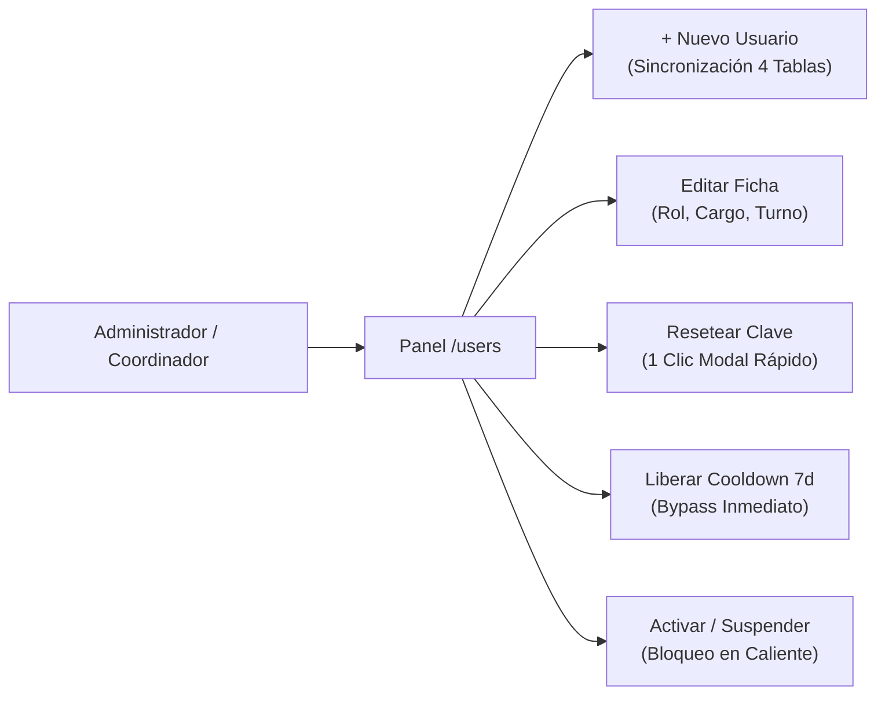
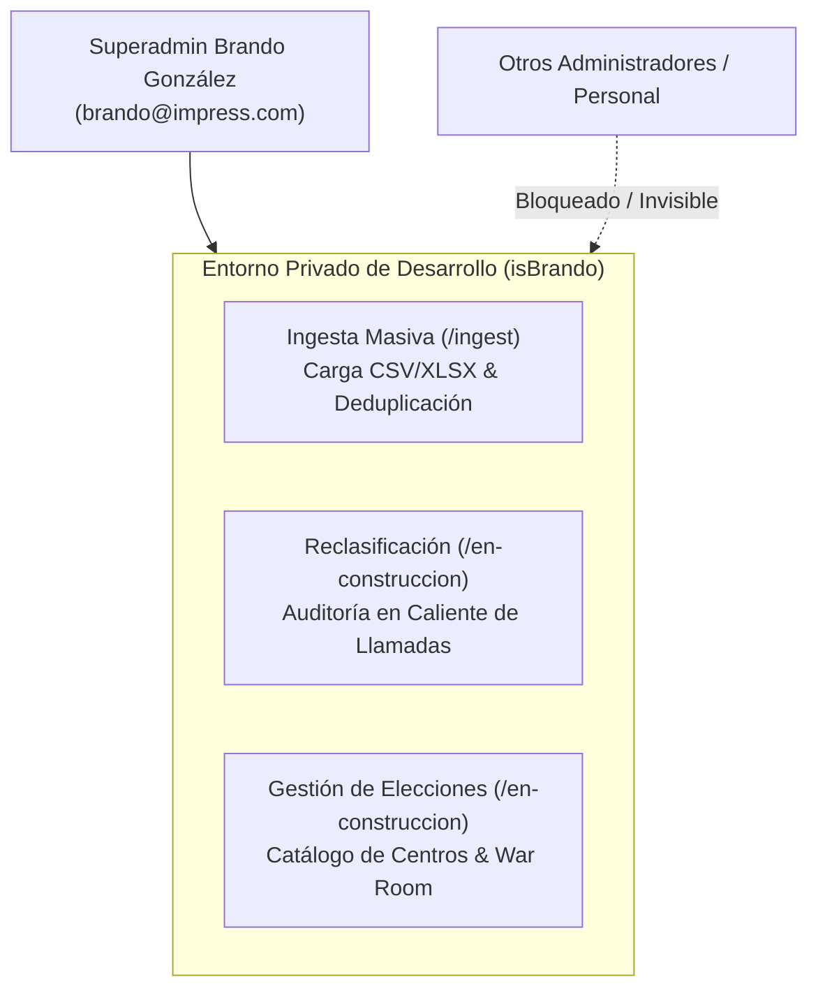

# MANUAL DE ADMINISTRACIÓN & GOBERNANZA RBAC
## NEXUS INTRANET PLATFORM v2.0
### Guía Maestra para Superadministradores, Administradores de Módulo y Coordinación General

---

### 1. Marco de Gobernanza & Niveles de Privilegio

El modelo de seguridad y control de acceso de **Nexus System** está basado en **Control de Acceso Basado en Roles (RBAC)** y directivas de seguridad a nivel de fila (*Row Level Security - RLS*) en PostgreSQL.

#### 1.1 Jerarquía Institucional de Roles

- **Superadmin (`superadmin`):** Acceso total a la infraestructura, configuración global, consolas de experimentación e ingesta masiva.
- **Module Admin (`module_admin`):** Administración funcional de campañas, dispositivos Samsung, asignación de metas y gestión de usuarios.
- **Coordinador General:** Mando operativo sobre la gestión de personal, modificación de turnos, habilitación de accesos y **liberación de restricciones de cooldown**.
- **Supervisor de Sala (`supervisor`):** Control de piso en llamadas y presencia; sin acceso a la administración global de cuentas.
- **Operador / Analista:** Personal operativo de ejecución diaria.

---

### 2. Panel de Gestión de Usuarios (`/users`)

El módulo de **Gestión de Usuarios** está ubicado en la ruta `/users` y en el Módulo 6 del Portal Maestro. Solo es visible y accesible para cuentas con rol de Superadmin, Module Admin o Coordinación General.

#### 2.1 Censo y Monitoreo de Personal (KPIs Superiores)
Al entrar al panel, dispones de 6 tarjetas de métricas en tiempo real:
1. **Total Cuentas:** Número total de identidades registradas (actualmente 78 cuentas).
2. **Activas:** Personal habilitado para iniciar sesión.
3. **Suspendidas:** Cuentas con acceso temporal o definitivamente revocado.
4. **Admins:** Balance de Superadmins y Administradores.
5. **Supervisores:** Encargados de control de sala.
6. **Operadores:** Personal activo en discado telefónico y análisis.

---

### 3. Procedimientos Administrativos Paso a Paso

#### 3.1 Procedimiento 1: Crear un Nuevo Usuario Corporativo
1. En `/users`, presiona el botón azul **+ Nuevo Usuario** en la esquina superior derecha.
2. Completa el formulario estructurado:
   - **Nombre Completo:** Nombres y apellidos oficiales del trabajador.
   - **Cédula / Documento:** Formato `V-12345678`.
   - **Correo Corporativo:** Debe finalizar estrictamente en `@impress.com`. El sistema valida la sintaxis institucional.
   - **Contraseña Inicial:** Mínimo 6 caracteres (se recomienda combinar letras, números y símbolos).
   - **Rol de Plataforma:** Selecciona el rol jerárquico (`multi_operator`, `supervisor`, `data_analyst`, `module_admin`, `superadmin`).
   - **Cargo / Sub-Rol:** Cargo funcional (ej. *Operador/a Telefónico*, *Supervisor de Sala*, *Coordinador General*).
   - **Turno:** Mañana, Tarde, Noche, Mixto o Completo.
   - **Teléfono, Dirección e Institución:** Datos de contacto y sede laboral.
3. Presiona **Registrar Usuario**.

> [!IMPORTANT]
> **Creación Atómica:** El sistema no solo crea la cuenta en Supabase Auth (`auth.users`), sino que genera simultáneamente el registro en `profiles`, asigna el rol en `user_roles` y crea la ficha en `usuarios` (la base de datos de Asys y Briana). El colaborador puede iniciar sesión de inmediato en cualquier terminal.

---

#### 3.2 Procedimiento 2: Resetear la Contraseña de un Operador
Si un colaborador olvidó su clave o reporta problemas de acceso:
1. En la tabla de usuarios, ubica al colaborador utilizando el buscador por nombre o correo.
2. En la columna **Acciones**, haz clic en el icono de la **Llave (`KeyRound`)**.
3. Se abrirá el modal rápido de cambio de credencial.
4. Escribe la nueva contraseña temporal (mínimo 6 caracteres).
5. Presiona **Actualizar Clave**.
6. La nueva contraseña se cifra con Bcrypt en Supabase Auth y se actualiza en el sistema de asistencia en menos de 1 segundo. Proporciona la nueva clave al colaborador.

---

#### 3.3 Procedimiento 3: Liberar la Restricción de 7 Días (Cooldown Bypass)
Cuando un operador comete un error al actualizar su teléfono o residencia y su perfil queda bloqueado por el temporizador semanal:
1. Ubica al usuario en la tabla de `/users`.
2. Observa la columna **Cooldown 7d**: si el usuario está bloqueado, verás la etiqueta `🔒 7d Activo` junto a un icono de reinicio (`RotateCcw`).
3. **Opción Rápida (1 Clic):** Pulsa directamente el botón de reinicio en la tabla. El sistema solicitará confirmación y liberará la restricción en el acto.
4. **Opción desde Edición:** Haz clic en **Editar**, marca la casilla *"Liberar Restricción de 7 Días (Cooldown)"* y presiona **Guardar Cambios**.
5. Al hacer esto, el campo `last_profile_edit_at` se restablece a `NULL`, el temporizador del usuario desaparece y este puede volver a editar su ficha de inmediato.

---

#### 3.4 Procedimiento 4: Suspender o Reactivar el Acceso de un Colaborador
Por motivos disciplinarios, desvinculación o licencias prolongadas:
1. En la tabla de usuarios, localiza la cuenta.
2. En la columna **Acciones**, haz clic en el botón del icono de usuario (`UserX` en rojo para suspender, o `UserCheck` en verde para reactivar).
3. Confirma la acción en el diálogo del navegador.
4. El sistema actualizará `is_active = false` en `profiles` y bloqueará de inmediato cualquier intento de inicio de sesión o renovación de sesión del usuario.

---

### 4. Módulos Reservados / Consola de Desarrollador (Founder Brando)

Nexus System cuenta con tres módulos de arquitectura avanzada que se mantienen **estrictamente aislados y reservados para la cuenta de desarrollador de Brando (`isBrando`)**:

1. **Ingesta Masiva de Datos (`/ingest`):**
   - Motor de importación masiva para lotes de telefonía sin colapsar la memoria de la base de datos.
   - Permanece reservado para calibración algorítmica y pruebas de carga antes de su apertura institucional.
2. **Reclasificación de Casos:**
   - Panel de auditoría de calidad para modificar tipificaciones telefónicas con versionado histórico.
   - Actualmente en fase de diseño de interfaz exclusiva.
3. **Gestión de Elecciones:**
   - Plataforma para mapeo geo-electoral (Estado, Municipio, Parroquia, Centro de Votación) y reporte de movilización popular en tiempo real.
   - Actualmente en fase de estructuración de catálogos y padrón.

---

### 5. Sincronización en Base de Datos & Triggers Automáticos

Para garantizar que los módulos heredados (Asys y Briana) funcionen armónicamente con el núcleo moderno de Supabase:

1. **Trigger `tr_sync_profile_to_asys`:**
   - Configurado en PostgreSQL sobre la tabla `public.profiles`.
   - Cada vez que un usuario o un administrador modifica nombre, cédula, teléfono o dirección en Nexus, este trigger propaga automáticamente los cambios a la tabla `public.usuarios` de Asys.
2. **Trigger `trigger_profile_cooldown`:**
   - Valida en la base de datos que ningún usuario sin rol de administrador pueda actualizar su perfil si no han transcurrido los 7 días reglamentarios desde su última edición.

---

### 6. Matriz de Recomendaciones Operativas para Administradores

> [!TIP]
> **Políticas de Seguridad Recomendadas:**
> - Nunca compartas las credenciales maestras de la cuenta Superadmin (`brando@impress.com`).
> - Antes de crear un nuevo colaborador, verifica que su cédula no exista previamente en el buscador de `/users` para evitar duplicación de identidades.
> - Al terminar la jornada de administración, cierra sesión mediante el botón *Cerrar Sesión* en el Portal Maestro para revocar los tokens de sesión del navegador.
