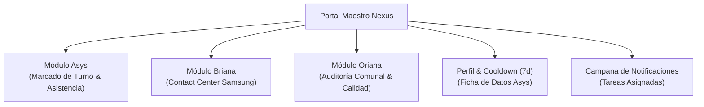
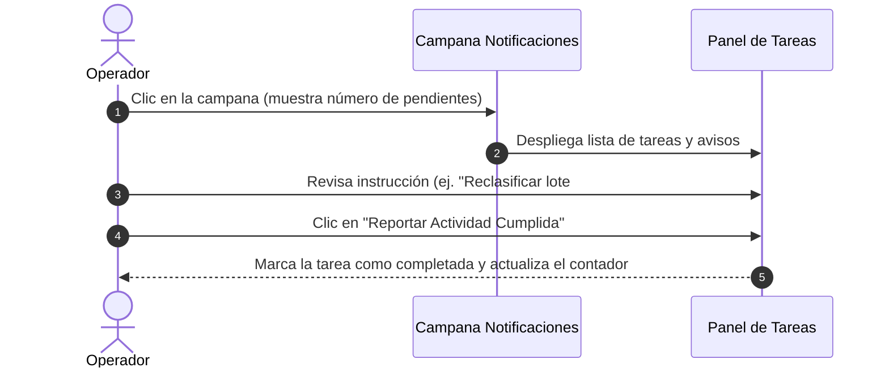

# MANUAL DE USUARIO OPERATIVO
## NEXUS INTRANET PLATFORM v2.0
### Guía Práctica para Operadores Telefónicos, Analistas de Calidad y Supervisores de Sala

---

### 1. Introducción al Ecosistema Nexus

Bienvenido a **Nexus System**, la plataforma tecnológica institucional integrada que centraliza todas tus herramientas de trabajo diarias: control de asistencia y presencia, gestión de llamadas telefónicas, auditoría de calidad y comunicaciones operativas.

> [!NOTE]
> Gracias a la tecnología de **Autenticación Única (SSO)** de Nexus, solo necesitas iniciar sesión una vez con tu correo corporativo `@impress.com`. A partir de allí, tendrás acceso directo a todos los módulos sin tener que ingresar contraseñas adicionales.

---

### 2. Acceso al Sistema (Inicio de Sesión)

1. Abre tu navegador web e ingresa a: **[nexus-system-three.vercel.app/login](https://nexus-system-three.vercel.app/login)**
2. En la casilla **Correo Corporativo**, escribe tu correo institucional completo (ejemplo: `tu_usuario@impress.com`).
3. En la casilla **Contraseña**, ingresa tu clave asignada.
4. Presiona el botón azul **Ingresar a Nexus**.
5. El sistema verificará tu identidad y te dirigirá automáticamente al **Portal Maestro de Nexus**.

> [!TIP]
> Si el sistema te indica error de credenciales, contacta a tu **Supervisor de Sala** o al **Administrador de Plataforma** para solicitar un reseteo directo de tu contraseña.

---

### 3. Navegación en el Portal Maestro

Al ingresar, verás la pantalla principal con los módulos autorizados según tu cargo y turno:

---

### 4. Módulo Asys: Control de Asistencia y Turnos

El módulo **Asys** registra tu presencia oficial, horas de guardia y puntualidad.

#### 4.1 ¿Cómo ingresar?
- Haz clic en la tarjeta verde **Módulo Asys** desde el portal principal.
- Aparecerá un mensaje de bienvenida confirmando tu sesión unificada.
- Presiona **Ingresar al Módulo**.

#### 4.2 Registro de Entrada y Salida (Reloj Biométrico)
1. **Entrada al Turno (Clock-In):** Al iniciar tu jornada, pulsa el botón de registro de entrada. El sistema guardará la hora exacta de servidor.
2. **Pausa / Almuerzo:** Registra tus salidas a descanso o almuerzo para garantizar el cálculo exacto de horas efectivas.
3. **Salida del Turno (Clock-Out):** Al finalizar tu turno diario, no olvides registrar tu salida.

> [!IMPORTANT]
> El registro de asistencia es auditado en tiempo real. En la barra superior de Asys siempre verás el botón `Mi Perfil & Cooldown (7d)`, el cual te permite revisar y actualizar tus datos personales en caso de cambio de teléfono o residencia.

---

### 5. Mi Perfil y Cooldown de 7 Días

Tu perfil almacena tu información laboral y de contacto. Está directamente enlazado con tu ficha en Asys.

#### 5.1 ¿Cómo consultar y editar tus datos?
1. Desde el Portal Maestro, haz clic en **Perfil y Cooldown (7 Días)** (o desde el botón de la barra de Asys).
2. Podrás visualizar tus datos inmutables:
   - Nombre y Apellido
   - Cédula de Identidad
   - Correo Institucional
   - Rol y Turno Asignado
3. Podrás modificar únicamente tus **datos de contacto**:
   - **Teléfono Personal / WhatsApp** (ejemplo: `+58 412 1234567`)
   - **Dirección de Habitación**

#### 5.2 ¿Qué es la Política de Cooldown de 7 Días?
Por normativa institucional de seguridad de la información:
- Cada vez que guardes cambios en tu teléfono o dirección, **se activará un bloqueo temporal estricto de 7 días continuos**.
- Durante estos 7 días verás un **temporizador digital en cuenta regresiva** indicando cuántos días, horas y minutos faltan para tu próxima edición permitida.
- Al guardar, tus nuevos datos se sincronizan automáticamente en tu ficha del Sistema de Asistencia (Asys).

> [!WARNING]
> Revisa cuidadosamente tu número y dirección antes de pulsar *"Guardar Cambios"*, ya que no podrás volver a editar tu perfil hasta que el temporizador llegue a cero (salvo autorización especial de tu Coordinador General).

---

### 6. Módulo Briana: Contact Center Telefónico para Samsung

**Briana** es la herramienta de emisión de llamadas y tipificación para operadores de sala.

#### 6.1 Acceso y Conexión
1. Desde el Portal Maestro, haz clic en **Módulo Briana**.
2. Tu extensión asignada y tu usuario se sincronizan automáticamente.
3. Presiona **Ingresar al Contact Center**.

#### 6.2 Flujo de Marcación Guiada (Paso a Paso)
1. **Recepción del Contacto:** En pantalla aparecerá el nombre, teléfono y datos de la persona a contactar según la campaña activa.
2. **Marcación en Terminal Samsung:** El discador guiado indicará el número a marcar o generará el enlace directo en el teléfono corporativo.
3. **Conversación:** Sigue el guión operativo institucional establecido para la campaña.
4. **Tipificación de la Llamada (Obligatorio):** Al finalizar la llamada, selecciona inmediatamente el resultado:
   - **Efectivo / Contactado:** La persona atendió y completó la interacción.
   - **No Contesta:** El teléfono timbró pero nadie atendió.
   - **Ocupado:** Línea en uso.
   - **Número Equivocado / Apagado:** Fuera de servicio o buzón de voz.
   - **Rechazado:** La persona no deseó atender la consulta.
5. **Reporte de Incidencias:** Si hubo algún problema técnico de línea, audio o datos, marca la casilla de incidencia y detalla una breve observación.
6. Pulsa **Guardar y Siguiente Contacto** para continuar con el lote.

---

### 7. Módulo Oriana: Auditoría Comunal y Calidad

Para el personal asignado al área de análisis y control de calidad:

1. Haz clic en **Módulo Oriana** desde el portal.
2. Accede al tablero de validación de lotes comunales.
3. Revisa los porcentajes de precisión de datos y los reportes de rendimiento diario.
4. Consulta tu posición en el ranking de analistas de sala para monitorear tu productividad por hora.

---

### 8. Centro Centralizado de Notificaciones y Tareas

En la esquina superior derecha del portal y de cada módulo encontrarás el icono de la **Campana de Notificaciones**.

1. **Indicador Numérico:** Si tienes tareas o avisos pendientes, la campana mostrará un punto con la cantidad.
2. **Tipos de Avisos:**
   - Asignación de nuevas campañas o lotes de llamadas.
   - Recordatorios de marcado de asistencia o guardias de fin de semana.
   - Instrucciones directas de la Coordinación General.
3. **Reportar Actividad Cumplida:** Cuando termines una tarea asignada, abre la notificación y presiona el botón **Reportar Actividad Cumplida**. Esto enviará una confirmación inmediata al sistema y archivará la tarea.

---

### 9. Preguntas Frecuentes (FAQ Operativo)

**P: ¿Qué hago si olvidé mi contraseña o no puedo entrar?**  
R: Comunícate con tu Supervisor o con el Administrador de Plataforma. Ellos cuentan con una herramienta de reseteo instantáneo de contraseñas y te proporcionarán una nueva clave en segundos.

**P: Me equivoqué al ingresar mi número de teléfono y el perfil se bloqueó por 7 días, ¿qué puedo hacer?**  
R: Explica la situación a tu Supervisor o Coordinador General. Desde el panel de *Gestión de Usuarios*, un administrador tiene la facultad de presionar el botón *"Liberar Cooldown"* para desbloquear tu perfil de inmediato.

**P: ¿Puedo tener Briana y Asys abiertos en pestañas diferentes?**  
R: Sí. Tu sesión de Nexus mantiene la identidad activa en todas las pestañas de tu navegador sin desconectarte.
